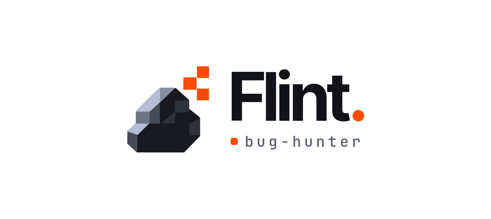
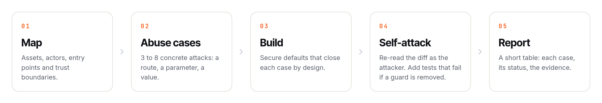

<div align="center">

<picture>
  <source media="(prefers-color-scheme: dark)" srcset="assets/logo-dark.png">
  
</picture>

### برمجة آمنة افتراضيا للوكلاء

مهارة (Agent Skill) تقرأ ميزتك بعين صائد الثغرات، والوكيل ما زال يكتبها.

[](LICENSE)
&nbsp;[](https://agentskills.io)
&nbsp;[](https://flint.ps)

[English](README.md)&nbsp;·&nbsp;[العربية](README.ar.md)

</div>

---

## لماذا موجودة

شركة Flint تبني البرمجيات وتكسرها كعمل يومي. وأكثر الثغرات التي نجدها ليست ذكية: شخص يغير رقما في الرابط فيحصل على فاتورة عميل آخر، أو webhook يقبل أي طلب يبدو قادما من Stripe، أو حقل "صورة من رابط" يصل إلى خدمة الـ metadata في السحابة. أدوات الفحص نادرا ما تلتقط هذا لأن الكود يعمل، هو فقط يثق بالشيء الخطأ.

الوكلاء اليوم يكتبون الـ endpoints أسرع مما يستطيع أحد مراجعته، ومعظم هذه الثغرات يصلحها سطر واحد أثناء الكتابة. لذلك دوّنّا الفحوصات التي يجريها المراجع الأمني في رأسه وأعطيناها للوكيل.

## ماذا تفعل

تحمل المهارة وحدها عندما تلمس المهمة شيئا حساسا: تسجيل الدخول، الصلاحيات، المال، رفع الملفات، الـ webhooks، روابط يجلبها الخادم، SQL أو shell، الأسرار، حزم جديدة، أو ميزات الذكاء الاصطناعي. وفي تغيير لون زر تبقى صامتة.

وعندما تحمل، يعمل الوكيل في خمس خطوات، بعد أن يقرر كم من الأمان يحتاجه التغيير فعلا.

<picture>
  <source media="(prefers-color-scheme: dark)" srcset="assets/workflow-dark.png">
  
</picture>

هذا المسار الكامل يعمل فقط لتغييرات المستوى الثاني. المستوى الأول يأخذ إعدادات آمنة بلا تقرير، والتغييرات البسيطة لا تأخذ شيئا. والتقرير لا يقول أبدا إن الكود آمن: يذكر ما فُحص، وكيف أُثبت، وما بقي من مخاطر.

## التثبيت

```bash
npx skills add flintsec/bug-hunter
```

لـ Claude Code فقط:

```bash
npx skills add flintsec/bug-hunter --skill bug-hunter --agent claude-code
```

يدويا:

```bash
git clone https://github.com/flintsec/bug-hunter
cp -r bug-hunter/skills/bug-hunter ~/.claude/skills/
```

المهارة تتبع صيغة [Agent Skills](https://agentskills.io) المفتوحة، لذلك يمكن لأي وكيل يقرأ هذه الصيغة أن يستخدمها.

## سكربت الفرز

مع المهارة سكربت صغير يقرأ التغيير، ويحدد الأسطح الحساسة، ويقترح الملفات المرجعية المناسبة. مكتوب بـ Python دون أي تبعيات، وتستطيع تشغيله بنفسك:

```bash
python skills/bug-hunter/scripts/triage_diff.py --git
git diff main...HEAD | python skills/bug-hunter/scripts/triage_diff.py - --format json
```

هو فرز نصي يدلك أين تنظر، ولا يحكم أبدا بأن شيئا ما آمن.

## كيف تبقى خفيفة

الوكيل يحمل المهارات على طبقات. الاسم والوصف فقط موجودان دائما، نحو 100 token. والملف `SKILL.md` يحمل عندما تناسب المهمة. أما الملفات المرجعية العميقة فلا تحمل إلا عند الحاجة، فمهمة الـ webhook تقرأ ملاحظات الـ webhooks فقط. والشرح الكامل لمبدأ العمل في [الدليل العربي](docs/bug-hunter-guide.ar.md).

## ما ليست عليه

ليست أداة فحص، وليست اختبار اختراق، ولا تغني عن مراجعة الكود أو تقييم أمني حقيقي. هي دفاعية: الوكيل يختبر كودك أنت داخل اختباراتك، ولا يهاجم أي نظام آخر.

## المساهمة

أكثر ما يفيد: حالات هجوم من ثغرات حقيقية منشورة، وملاحظات لأطر عمل جديدة، ومهام للـ bench. اقرأ [CONTRIBUTING.md](CONTRIBUTING.md) أولا.

## الرخصة

الرخصة MIT. بناء [Flint](https://flint.ps)، استوديو هندسة ويب واختبار أمني في غزة، فلسطين.
