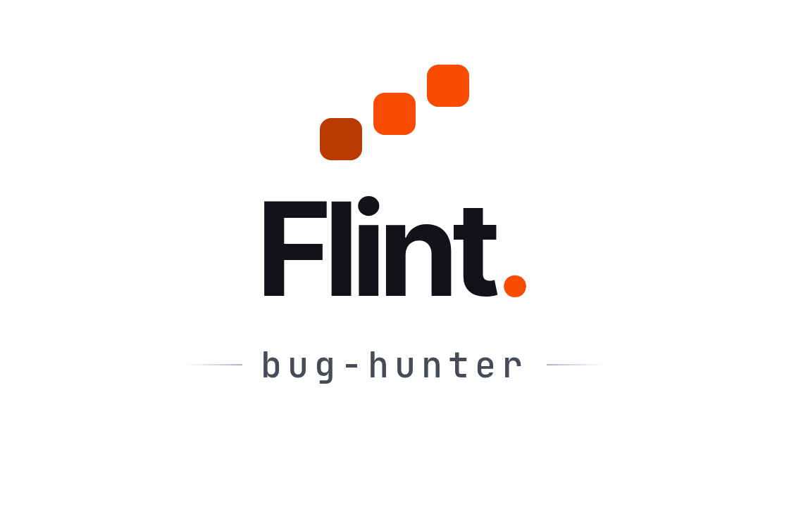
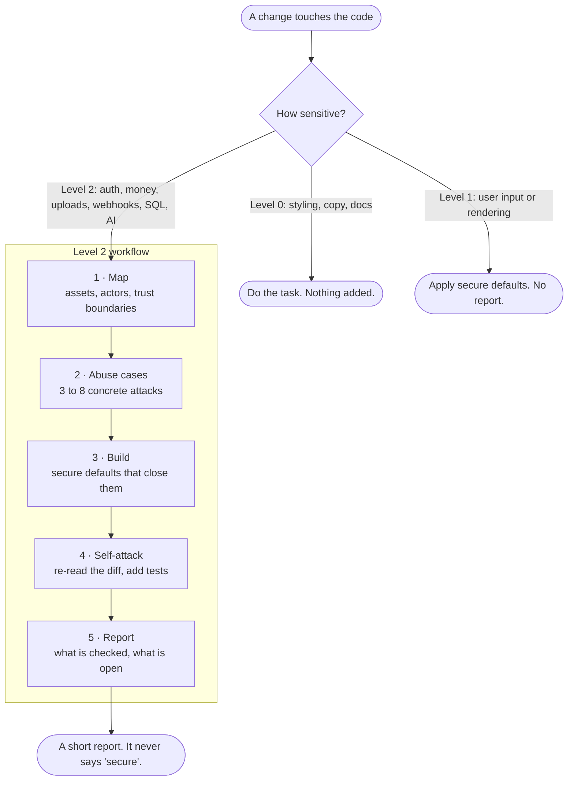

<div align="center">

<picture>
  <source media="(prefers-color-scheme: dark)" srcset="assets/logo-dark.png">
  
</picture>

### Secure-by-default coding for agents

An agent skill that reads your feature the way a bug bounty hunter would, while the agent is still writing it.

[](LICENSE)
&nbsp;[](https://agentskills.io)
&nbsp;[](https://flint.ps)

[English](README.md)&nbsp;·&nbsp;[العربية](README.ar.md)

</div>

---

## Why it exists

Flint builds and breaks software for a living. The bugs we find most often are not clever: someone changes an ID in a URL and gets another customer's invoice, a webhook accepts any request that looks like it came from Stripe, a "set avatar from URL" field reaches the cloud metadata service. Scanners rarely catch these, because the code works. It just trusts the wrong thing.

Agents now write endpoints faster than anyone can review them, and most of these bugs take one line to fix while the code is being written. So we wrote down the checks a security reviewer runs in their head and handed them to the agent.

## What it does

The skill loads on its own when a task touches something sensitive: auth, permissions, money, uploads, webhooks, URLs the server fetches, SQL or shell, secrets, new packages, or LLM features. For a button color it stays quiet.

When it loads, the agent works in five steps, after deciding how much security the change actually needs.



The report never claims the code is secure. It lists what was checked, how it is proven, and what risk remains.

## Install

```bash
npx skills add flintsec/bug-hunter
```

For Claude Code only:

```bash
npx skills add flintsec/bug-hunter --skill bug-hunter --agent claude-code
```

Manual install:

```bash
git clone https://github.com/flintsec/bug-hunter
cp -r bug-hunter/skills/bug-hunter ~/.claude/skills/
```

The skill follows the open [Agent Skills](https://agentskills.io) format, so any agent that reads that format can use it.

## Example

You type a normal request.

> Add a route so a logged-in user can download the PDF of one of their invoices.

The agent writes the route, scopes the query to the current user, keeps the PDFs on a private disk, adds a test where a second user gets a 404, and ends with this:

```markdown
### Security notes

Level 2: invoice download (object access, private files)

| # | Abuse case | Status | Evidence |
|---|---|---|---|
| 1 | Customer B changes the invoice ID to download customer A's invoice | Mitigated, tested | `$request->user()->invoices()->findOrFail()`; `test_user_cannot_download_another_users_invoice` |
| 2 | Logged-out visitor guesses download URLs | Mitigated, tested | Route in the `auth` group; `test_guest_is_redirected_to_login` |
| 3 | Attacker reads PDFs straight from `/storage` | Mitigated, not tested | Files on the `local` disk outside `public/` |

Tests added: `tests/Feature/InvoiceDownloadTest.php` (3 tests)
Residual risk: no rate limit on the route yet.
```

## How it stays cheap

Agents load skills in layers. Only the name and description stay in context all the time, around a hundred tokens. `SKILL.md` loads when a task matches. The deep references load only when the change needs them: access control, injection, SSRF and webhooks, files, business logic, secrets, configuration, dependencies, LLM features, and framework notes for Laravel, Node, Python, Supabase and Firebase. A webhook task reads the webhook notes and skips the rest.

## Triage script

The skill ships a small script the agent can run on a change. It reads the diff, finds the sensitive surfaces, and names the reference files worth reading. It is plain Python with no dependencies, and you can run it yourself.

```bash
python skills/bug-hunter/scripts/triage_diff.py --git
git diff main...HEAD | python skills/bug-hunter/scripts/triage_diff.py - --format json
```

It is a regex triage. It finds places to look, and never decides that something is safe.

## What it is not

It is not a scanner and not a pentest. It does not replace code review or a real security assessment. It is defensive: the agent tests your own code in your own test suite, and does not attack other systems.

## Contributing

The most useful contributions are abuse cases from real, already disclosed bugs, framework notes, and bench tasks. Read [CONTRIBUTING.md](CONTRIBUTING.md) first.

## License

MIT. Built by [Flint](https://flint.ps), a web engineering and security testing studio in Gaza, Palestine.
